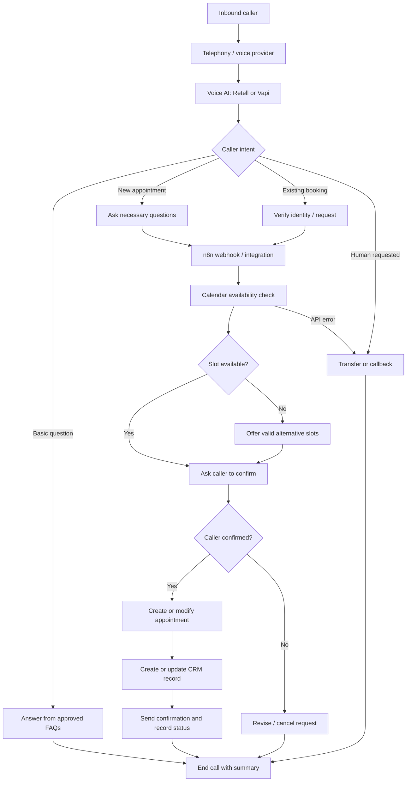

# AI Voice Receptionist — Architecture & Integration Portfolio

**Inbound AI calling · Appointment scheduling · Lead qualification · CRM handoff**

> **Portfolio status:** Reference architecture + runnable normalization example. This repository is an educational, sanitized technical showcase—not a connected, deployed phone agent. No client data, live credentials, real call recordings, or performance claims are included.

## Overview

An AI voice receptionist can answer incoming calls, understand why someone is calling, answer approved business FAQs, collect a qualified lead, check appointment availability, confirm a booking, and hand off to a human when necessary.

This portfolio shows how I would design, integrate, and test that workflow using **Retell AI or Vapi**, **n8n**, a **calendar**, a **CRM**, and a telephony provider. Provider selection depends on client needs and actual API access.

## Business problem

A busy service company may miss inbound calls, enter customer details manually, or struggle to handle appointment requests consistently. The solution is a guided, auditable call flow with calendar verification, secure record updates, failure handling, and human escalation.

## Architecture



## Example solution capabilities

| Area | Behavior |
| --- | --- |
| Inbound reception | Greeting, intent detection, approved FAQ answers |
| Lead intake | Capture name, contact details, service need, and urgency when appropriate |
| Booking | Check live availability, read back the proposed slot, confirm, then create booking |
| Existing appointments | Route reschedule and cancellation through verified and authorized tools |
| CRM synchronization | Upsert lead/customer record; log call outcome without unnecessary raw transcripts |
| Transfer and recovery | Escalate complex requests, tool failures, or human requests |
| Notifications | Send booking or callback summaries through approved channels |

## Example stack (swappable components)

- **Voice platform:** Retell AI / Vapi
- **Telephony:** Twilio / Telnyx or provider-supported numbers
- **Automation:** n8n using webhooks and HTTP Request nodes
- **Calendar:** Google Calendar / Cal.com
- **CRM:** GoHighLevel / HubSpot / another client CRM
- **AI model:** A model supported by the selected voice platform

These are integration options, **not claims of configured live accounts**.

## Suggested repository tour

- [Architecture & call flow](docs/architecture.md)
- [Example agent instructions](docs/agent-prompt.md)
- [Integration payloads](examples/sample-events.json)
- [Runnable n8n-compatible lead normalizer](examples/normalize-lead.js)
- [Local tests for the normalizer](examples/normalize-lead.test.js)
- [Test scenarios & acceptance criteria](docs/test-scenarios.md)
- [Deployment prerequisites & security](docs/setup-and-security.md)

## Try the local demo

The Node.js normalization module does **not** call real phone, calendar, or CRM APIs. It transforms a synthetic lead payload into a consistent object and checks for invalid contact data.

```bash
node examples/normalize-lead.test.js
```

Requires Node.js 18+; no packages to install.

## Example outcome (synthetic)

A caller requests an HVAC assessment, provides consented contact details, chooses an available slot, confirms the date and time, and receives a booking confirmation. An n8n workflow writes the call outcome to the chosen CRM. If availability or CRM lookup fails, the agent avoids claiming success and offers a transfer or callback.

## What is included / not included

**Included:** system design, sample conversation policy, synthetic payload examples, a runnable normalization helper, and a thorough test plan.

**Not included:** production voice agent, imported Retell/Vapi setup, deployed n8n workflow, working calendar/CRM credentials, validated live call recordings, or performance benchmarks. Those require a real configured environment and client authorization.

## About

Created as a public technical portfolio reference by **Kenniz | KZ Automation**.

[Explore my GitHub portfolio](https://github.com/kennizautomation)
